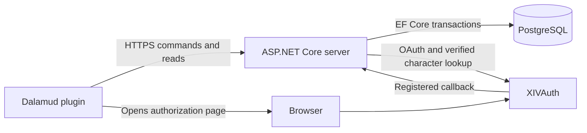

# Architecture

This describes the implemented system for plugin/server 0.0.6.21. Older milestone
plans and release records describe their own checkpoints; they are not the current
source map. See [repository layout](repository-layout.md) for file navigation and
[versions](versions.md) for dependency pins and protocol boundaries.

## Applications and dependencies

Amor RP has two separately built applications in one repository: a Windows Dalamud
plugin and an ASP.NET Core server. The server uses PostgreSQL and verifies character
ownership through XIVAuth. Render hosts the public service; secrets stay in deployment
configuration. The plugin's release endpoint is fixed in `ProductServer`.

| Project | Implemented responsibility | Dependencies |
| --- | --- | --- |
| Plugin | ImGui views, drafts, request coordination, protected local settings, game adapters | Core, Contracts, Dalamud |
| Server | HTTP authorization, feature rules, transactions, persistence, provider adapter, workers | Core, Contracts, ASP.NET Core, EF/Npgsql |
| Core | Pure text/chat validation, crafting type classification, community capacity policy | No application project references |
| Contracts | Transport records, shared field limits and legacy wire conversion | No application project references |

The server and plugin do not reference each other. Core does **not** currently own
all use cases, inventory accounting or trade transitions. Those rules live beside
their EF transactions in server feature services. Moving every rule into another
layer is not a prerequisite for maintaining this structure.

## Server ownership and consistency

Feature endpoints bind concrete requests and call feature services. Services check
current sessions, active community membership and the capability required by the
action. Group-private member lists and announcements additionally require group
membership; community moderation does not bypass that check.

The database is authoritative for balances, reservations, inventory, quotas and
permissions. Commands use advisory locks across server replicas, expected versions,
constraints and atomic transactions. `CommandStore` records request fingerprints
and protected responses for deduplication and recovery. A client timeout cannot be
interpreted as proof that a command failed.

Trading separates the short locked expiry transaction from consistent read-only
response assembly. `TradeReservations` is shared with membership changes and the
expiry worker. Commands also enforce expiry themselves, so worker delays cannot
make stale reservations authoritative indefinitely.

Authentication retains a global lock for short login admission, callback completion
and pairing transactions. Renewal and revocation use a **per-session** database
lock instead. A slow XIVAuth renewal serializes mutations of that session, without
holding the global login lock. Revocation receipt writes also serialize per actor.
The provider call still holds that session's transaction/connection; this is a
bounded, deliberate tradeoff that preserves single-use renewal and revocation
ordering without adding a persisted claim protocol. It is not a connection-pool
capacity guarantee. See [authentication](authentication.md).

## Plugin requests and state

`CommunitiesPanel` owns the selected verified character/community, view data and
editors. Its partial files share that state; they are not independently instantiated
controllers. The shell and game/media adapters have their own lifecycle boundaries.

`RequestCoordinator` owns the foreground and core-refresh task lanes, cancellation,
view generation and data generation. Network work returns callbacks; the UI thread
collects current results and applies them. A character/scope reset cancels both
lanes and rejects their late results, including failures. Community changes invalidate
view results. Mutations and accepted tokens invalidate older core/feature reads.
A core response waits while renewal is in progress, then is checked against the
accepted-token generation before its status can affect the session.

Core refresh reads capabilities and the character's community list. Secondary
features have separate `BackgroundRefresh<T>` instances with independent loading,
retry and error state. A failed events or media read does not discard a successful
inventory read. Trade and announcement pollers remain separate. Favorite events
refresh independently and feed a five-day UTC HUD while the main menu is closed.

`CommandRoutes` maps exact HTTP verbs and route shapes to named operations, result
handlers and refresh targets. `CommandCompletionScreens` dispatches to the matching
handler rather than trying every feature parser. Unknown routes do not select a
result parser. Recovered results for another community cannot overwrite the current
editor. Stored pending requests retain their original method/path/body/ETag for
server replay; dispatch conversion does not rewrite that wire identity.

`GroupProfileDraft` owns its complete dirty-state definition, including joining mode
and password. `TradeDraft` preserves local offers through peer updates. Pending writes
and saved sessions use Windows CurrentUser DPAPI and remain bound to their original
server/character. Actual chat submission is isolated in the game adapter and requires
explicit user intent; replayed use receipts do not automatically resend chat.

## Verification and limits

Contract tests check project dependency boundaries. Plugin helper tests compile the
same production transport, draft, refresh and request-coordination sources without
Dalamud. They exercise cancellation, delayed results, token rotation, replay and
cross-community recovery. Server tests use disposable PostgreSQL databases and
provider fakes, including a deliberately stalled provider for concurrency checks.
No additional hosted testing server is required.

These tests do not render ImGui or execute the entire game-hosted panel. Windows
package CI checks real Dalamud references; placement, input and native game behavior
still require in-game checks. The panel remains a substantial shared coordinator.
Future extraction should follow concrete state ownership or observed defects.

## Planned extensions

WebSocket invalidation, an item-handler/renderer registry, and export/data-lifecycle
endpoints marked planned in OpenAPI are not implemented. Current updates use HTTP
polling. They must not be described as existing dependencies or release guarantees.

Amor RP's current API is `/api/v2`; XIVAuth independently uses `/api/v1/characters`.
The remaining v1 wire adapter and persisted request/receipt conversion are described
in [API](api.md). This maintenance release changes neither protocol.
