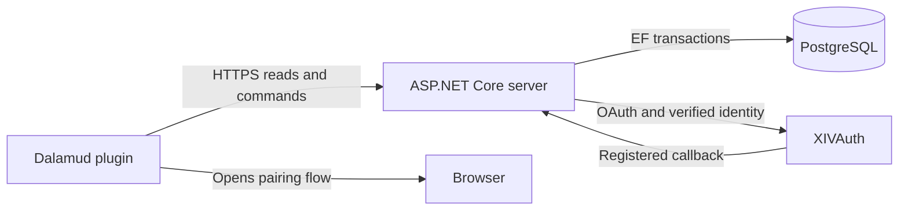

# Architecture

Amor RP has two applications: a Windows Dalamud plugin and an ASP.NET Core server
using PostgreSQL. XIVAuth verifies character ownership. The maintainer's private
home host runs the service. See the [source map](repository-layout.md),
[data model](data-model.md) and [current milestone plan](../planning/README.md).

| Project | Responsibility |
| --- | --- |
| Plugin | ImGui views/drafts, protected settings, request coordination, game and media adapters |
| Server | Authoritative feature rules, authentication, authorization, transactions, persistence and workers |
| Core | Pure reusable text/chat validation and crafting-type classification |
| Contracts | Transport records, shared limits and ApiProtocol constants |

Plugin and server never reference one another. Pure Core/Contracts projects have
no game, HTTP or database dependencies. Feature rules stay beside their server
transactions; moving all rules into a new abstraction layer is not a maintenance goal.

## Server consistency

Feature endpoints bind concrete requests and call services. Services retain explicit
session checks, canonical ordered advisory locks, locked reauthorization, ETags,
replay and receipt ordering. CommandStore commits the original protected response
with the mutation and rejects fresh inactive-season gameplay writes. A timeout is
an unknown outcome, not proof that nothing happened.

SeasonMemberships provides one idempotent enrollment path. Every verified character
belongs to every non-deleted season; RP-group authority and private content remain
separate. Global seasons.create and lifecycle authority are distinct from season
ownership and group staff grants. No alternate community model or old API adapter exists.

CurrencyAccounts, TreasuryLedger, DebtSettlement and TradeReservations share the
financial primitives. Features still own their business decisions and transactions.
All income settles old claims using unreserved funds. Bounded collection persists
continuation/holds; workers recheck lifecycle and never mint currency. Group disband
settles to the actual owner; overflow/unpaid claims retain owner-only return paths.

Trade reads expire state in a short locked transaction, then assemble a consistent
response without keeping the write lock over every read. Commands independently
check expiry/revision, so delayed workers cannot authorize stale reservations.

Authentication keeps admission/callback/pairing transactions short and serializes
renewal/revocation per session. Provider calls can hold that session's transaction
and connection; the timeout is bounded, not a capacity guarantee. See
[authentication](authentication.md) for rotation and recovery limits.

StaticImageUpload is the shared hostile-input/normalization boundary. MediaAssets
handles fingerprints, asset construction, purpose/season-scoped PNG reads and cleanup.
Currency/season/group services retain their different ownership, limits, versions,
receipts and transactions. Stored purpose names and asset IDs remain unchanged.

## Plugin state and transport

PluginTheme scopes the shared palette/rounding around WindowSystem.Draw and restores
the ImGui stack afterwards. Launcher buttons use one icon renderer and actual window
state for highlighting/toggling; Trade uses its normal close lifecycle.

The shell owns independent windows. SeasonsPanel partials share current verified
character/season, feature data and editor state. They are not separate controllers;
future extraction should follow real state ownership and tests, not filename count.
Inventory and Writing have independent filters, selection and pagination.

RequestCoordinator distinguishes foreground mutations/reads and background sync,
with generation checks that discard stale results. Feature refreshers isolate retry,
error and freshness state. GroupProfileDraft and TradeDraft own complete dirty-state
rules; context changes protect unfinished edits. HTTP polling is implemented;
WebSocket invalidation is planned.

CommandRoutes resolves exact verbs and paths to operation/result/refresh handlers.
CommandRequest is already the current shape. Pending requests retain original
method/path/body/ETag and operation key; no translation changes replay identity.
Unknown routes never choose a parser or become another mutation. Results for a
different season do not overwrite the active editor. Game chat lives in a dedicated
adapter and is never automatically resent by receipt recovery.

Saved sessions, pending commands and personal notes use Windows CurrentUser DPAPI
and origin/character binding. Preserve serialized keys, cryptographic purposes and
ImGui window IDs during refactoring. Feature visibility is not server authorization.

## Build, protocol and verification

Directory.Build.props is the release-version source. ApiProtocol owns the separate
wire-support floor; ServiceCompatibility checks advertised versions and API. The
server reports its built assembly version. Main-only publication uses exact Windows
artifacts and immutable versioned packages after both source CI workflows pass.

Contract tests check project boundaries; helper tests compile production pure
transport/draft/coordinator code without Dalamud. Integration tests use isolated
PostgreSQL and fake providers, including stalled-provider concurrency tests. CI
also builds the server container and checks model/docs/package/deployment integrity.
These checks do not render ImGui or prove game interaction, host capacity or a restore.
Planned export/deletion, WebSocket and expansion endpoints are labeled in OpenAPI.
