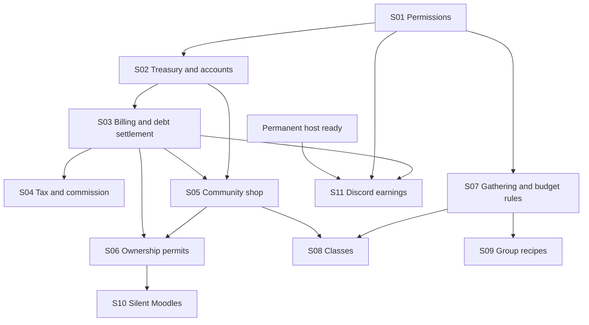

# Expansion work plan

Planning baseline: 2026-10-29. Implemented release: plugin/server 0.0.6.21,
source `d2316f5`. S01 (0.1.0.0) passed the maintainer's major in-game checks on
2026-10-29. S02 (0.2.0.0) implementation is delivered; its in-game acceptance is pending.
Everything else in this directory is **planned**, unless its work item
below is explicitly completed with implementation and verification evidence.
Amor RP API remains v2 and XIVAuth's external API remains v1; no protocol change
is planned here. Future feature migrations and release versions are chosen per slice.
This is the working plan for the maintainer's current feature list. It supersedes
earlier suggestions in the conversation, not the description of deployed behavior.

## Documents

- [Decisions](decisions.md): agreed rules, proposed defaults and deferred choices.
- [Hosting and releases](hosting-and-releases.md): private Ubuntu target, migration
  prerequisites, main-only development and 0.feature.0.patch versions.
- [Economy and groups](economy-and-groups.md): permissions, treasury, billing, debt,
  commissions, taxes, shop and ownership permits.
- [Gameplay](gameplay.md): gathering, classes and group recipes.
- [Integrations](integrations.md): silent Moodles integration and opt-in Discord earnings.

Current implementation references: [architecture](../engineering/architecture.md),
[source map](../engineering/repository-layout.md), [API](../engineering/api.md) and
[development workflow](../delivery/development.md). These expansion documents do
not mark endpoints implemented or promise a release number/date.

## Work order and dependencies

Each row is a bounded work item, not a new branch, service or promised single release.
Implement and verify one item before starting a dependent item. The numbered order
is the recommended sequence; dependencies show which items can move independently.

| ID | Work item | Requires | Completion evidence |
| --- | --- | --- | --- |
| S01 | Organize community permissions; add group feature approval and staff grants | Existing membership/ownership | Server rejects cross-group grants and escalation; unauthorized tabs stay hidden; existing permissions still work |
| S02 | Currency accounts, group treasury, receipts and disband settlement | S01 | Concurrent transfers conserve currency; reservations/replays remain correct; assets transfer to the actual group owner exactly once |
| S03 | Trusted billing, character debt and full automatic collection | S02 | Offline bills work; duplicate delivery never repeats a charge; priority/partial collection and cyclic payment cases terminate correctly |
| S04 | Taxes, cashier commission and basic clock-in | S03 | Collected money splits exactly; later debt repayments use saved allocation; commission income also pays the cashier's own debts |
| S05 | Community shop and regulated purchase outcomes | S02, S03 | Purchases are atomic, affordable and replay-safe; authorized group/character buyers receive the correct item or registered document |
| S06 | RP ownership permits and owner-managed release | S03, S05 | Explicit initial OOC acceptance; full cost preview; insufficient funds change nothing; deleting a permit/disbanding releases its character |
| S07 | Gathering packages and configurable crafting-point bonuses | S01, existing inventory | Shared weekly production budget, configurable costs and receiving limits, replay-safe use and consistent reset behavior |
| S08 | Community classes and reset potion (nice to have) | S01, S05, discipline/budget rules checked in S07 | Slot limits and permanent choices work; reset is charged once; switching never resets spent weekly budgets |
| S09 | Group-restricted recipes (nice to have) | S01, existing groups/recipes; budget rules checked in S07 | Membership and recipe/crafting permissions enforced; configured limits cannot be evaded by recreation |
| S10 | Silent optional Moodles integration | Existing consumable use, S06 for the ownership effect | Supported IPC tested in game; own effects reconcile correctly; absence/rejection produces no user-facing feedback or failed gameplay action |
| S11 | Inviteable Discord bot and writing earnings | S01, S03, permanent-host readiness | End-to-end linking/opt-in, earning caps, account selection, restart/deduplication and automatic unlink/leave verified |

S07 does not need a shop, classes or Discord. S09 does not need classes. S11 does
not need permits, classes or Moodles. S10's IPC proof can happen early without
shipping its integration or changing game behavior. Accounting/authorization must
be complete before enabling any new spending or earning path. Nice-to-have work
must not hold up a ready required feature; the dependency graph, not row position,
controls that decision.

## Progress checklist

- [x] S01 acceptance — [0.1.0.0 implementation and verification](../delivery/release-0.1.0.0.md); maintainer confirmed major checks work on 2026-10-29
- [ ] S02 acceptance — [0.2.0.0 treasury implementation](../delivery/release-0.2.0.0.md); major in-game checks pending
- [ ] S03 billing/debt/automatic collection
- [ ] S04 taxes/commission/clock-in
- [ ] S05 community shop
- [ ] S06 ownership permits/release
- [ ] S07 gathering packages
- [ ] S08 classes/reset potion
- [ ] S09 group recipes
- [ ] S10 silent Moodles
- [ ] S11 Discord earnings

Mark a box only with a link to the code/release and relevant automated/manual
verification. Record partial progress beneath the corresponding feature document;
do not treat a draft migration or a successful build as feature completion.

## How to work an item

1. Read its accepted decisions and dependencies. Check the current source/release.
2. Settle only details needed for that item. Ask the maintainer only if an ambiguity
   changes authority, ownership, preservation of funds/assets or an external dependency.
   Use clearly labelled, reversible defaults for routine UI/configuration details.
3. Write a small implementation checklist beside that feature: data/migration,
   server rules, transport, UI and verification. Avoid designing every future field now.
4. Reuse existing server transaction/receipt, inventory, scope and permission mechanisms.
   Isolate new integration adapters and feature-owned state. No broad rewrite,
   generic workflow engine or unrelated authentication/provider change.
5. Test the actual risks, update current API/rules/docs when implemented, and record
   the result. Keep migrations, plugin update and server redeployment requirements explicit.
6. Complete the slice before adding another dependent feature. Keep the normal main
   feed and current hosting arrangement; these work IDs do not create milestone branches.

## Later expansions

Track these separately after their foundations:

- [ ] L01: Group item storage after S02 and server-validated group item transfers.
  Disbanded stored assets go to the owner under the same settlement rule.
- [ ] L02: Permit trading after S06 and a complete registration/billing-lock transfer rule.
- [ ] L03: Shift schedules, per-staff rates and further ownership/shop rules when requested.

These are separate follow-ups.
Currency treasury and a registered ownership document do not require a general
shared item warehouse. Permit trading must transfer the registration and billing
lock together; an ordinary inventory transfer is insufficient.

The selected future target is a private Ubuntu server on the maintainer's GMKtec
NucBox M8. Render stays testing until the controlled cutover. Use main only and
0.feature.0.patch release numbers; see [hosting and releases](hosting-and-releases.md).
A second paid Render test service is not required.
